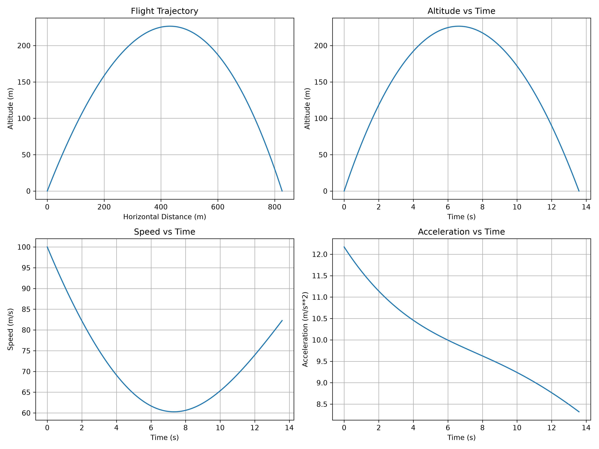
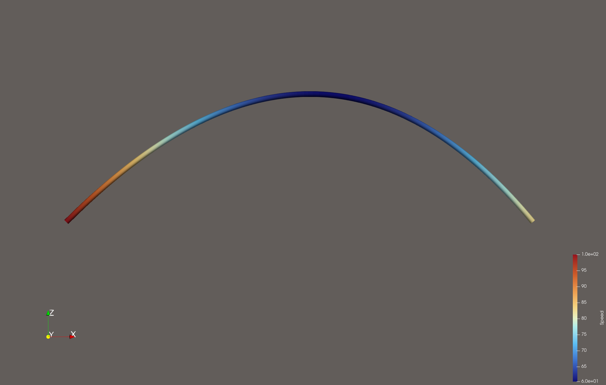

# Flight Trajectory Simulator

**Python-Based Computational Physics Project | Aerospace Flight Dynamics**

## Project Overview

This project uses Python to simulate the flight trajectory of an unpowered vehicle under the effects of gravity and aerodynamic drag.

The program calculates the vehicle's position, velocity, acceleration, maximum altitude, flight time, and horizontal range. It also generates graphs to visualize the flight and exports simulation data for visualization in ParaView.

I developed this project independently to apply concepts from classical mechanics, differential equations, and computational physics to an aerospace-related problem.

## Physics and Mathematical Model

The simulation uses Newton's second law and a simplified aerodynamic drag model.

The gravitational force is:

$$
F_g = mg
$$

The aerodynamic drag force is:

$$
F_D = \frac{1}{2}\rho C_D A v^2
$$

The equations of motion are:

$$
\frac{dx}{dt} = v_x
$$

$$
\frac{dy}{dt} = v_y
$$

$$
\frac{dv_x}{dt} = -\frac{\rho C_D A}{2m}v v_x
$$

$$
\frac{dv_y}{dt} = -g - \frac{\rho C_D A}{2m}v v_y
$$

The equations are solved numerically using SciPy's `solve_ivp` function.

## Features

- Simulates two-dimensional flight trajectories.
- Allows users to modify initial conditions and physical parameters directly in the Python script to simulate different flight scenarios and calculate the resulting flight characteristics.
- Models gravitational acceleration and aerodynamic drag.
- Calculates maximum altitude, flight time, horizontal range, speed, and acceleration.
- Generates graphs of trajectory, altitude, speed, and acceleration.
- Exports simulation results as CSV and VTK files.
- Supports trajectory visualization in ParaView with speed-based colour mapping.

## Tools and Libraries

- Python
- NumPy
- SciPy
- Matplotlib
- ParaView

## Simulation Results

### Flight Dynamics Graphs

The following graphs show the simulated trajectory, altitude, speed, and acceleration over the course of the flight.

### ParaView Visualization

The flight trajectory was exported to ParaView for visualization, with colours representing the vehicle's speed along its path.

## How to Run

1. Download or clone this repository.
2. Install the required Python libraries:

   `pip install -r requirements.txt`

3. Run the Python script:

   `python trajectory_simulator.py`

4. Open the generated `trajectory.vtk` file in ParaView to visualize the trajectory.

## Limitations

This is a simplified two-dimensional model that assumes constant gravity, atmospheric density, and drag coefficient. It does not account for thrust, wind, changing atmospheric conditions, or aerodynamic heating.

The simulation is intended to demonstrate introductory flight dynamics and numerical modelling rather than represent a high-fidelity aerospace vehicle simulation.